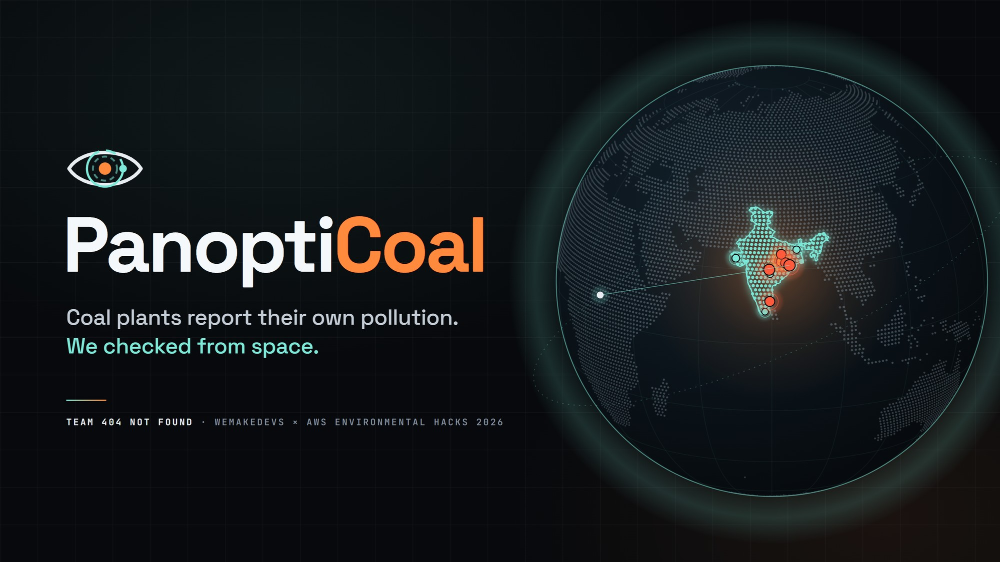
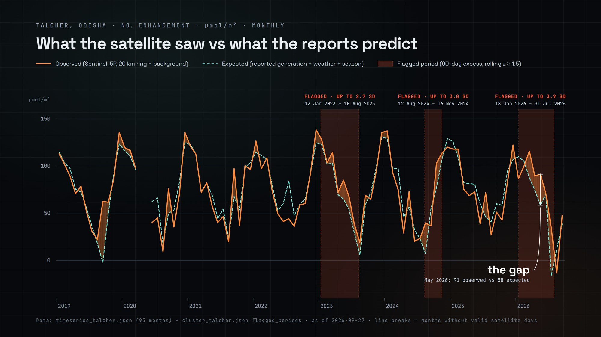
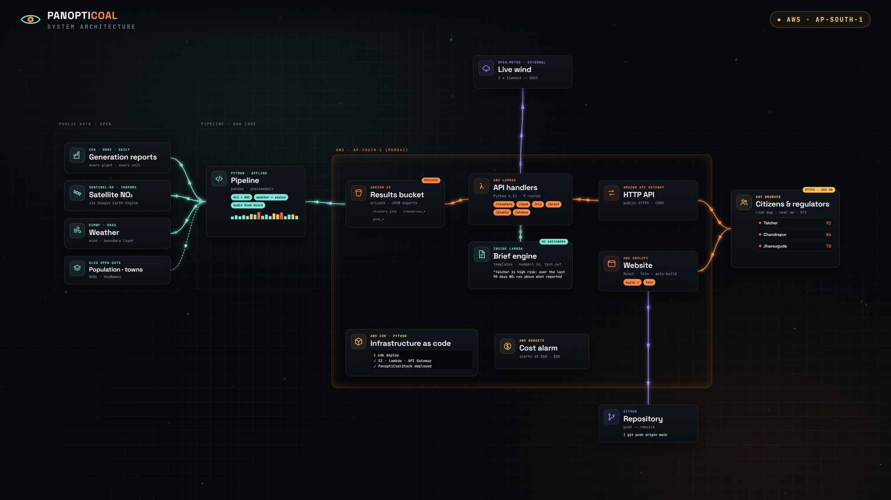
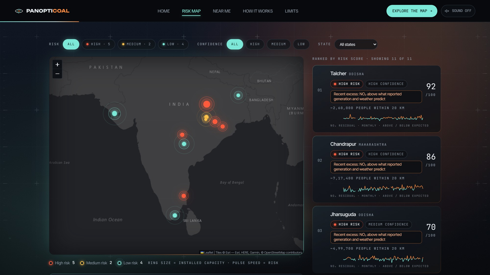
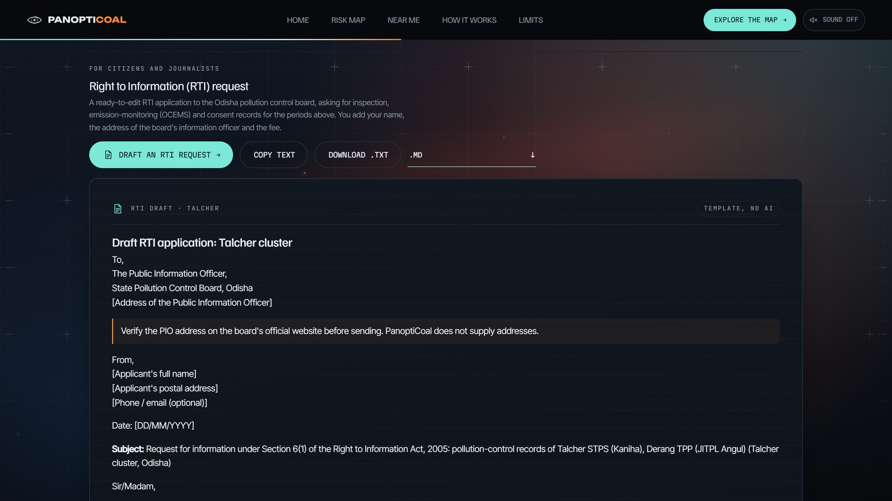

# PanoptiCoal

**Satellite-verified accountability for India's coal power plants.**

> Coal plants report their own pollution. We watch from space.

**Live site:** https://main.ddbebutv5mmwf.amplifyapp.com · **API:** https://cn1ob2edc1.execute-api.ap-south-1.amazonaws.com

**Team 404 Not Found:** Krish Jain (team lead) · Suhani Jain



PanoptiCoal compares how hard India's coal power plants actually ran (from government generation reports) with how much pollution satellites see above them (from the European Space Agency's Sentinel-5P satellite). Where the two stop matching over a sustained period, the plant cluster gets a higher **Audit Risk Score**, so regulators know where to inspect first and residents know what is in their air.

*Status: submission for **Environmental Hacks** (WeMakeDevs × AWS Bharat Builds Tour, event 02, Air track), October 2026. Deployed live on AWS in Mumbai. Results indicate anomalies that warrant an audit. They are not proof of any violation.*

### At a glance

| | |
|---|---|
| Coal clusters analysed | **11** (Singrauli, Korba, Marwa, Jharsuguda, Talcher, Chandrapur, Mundra, Ramagundam, Kahalgaon, Neyveli, Tuticorin) |
| Daily observations modelled | **19,183 cluster-days** (2019 to Sept 2026) |
| People living within 20 km of the 11 clusters | about **7.7 million** |
| Coal plants mapped state-wise | **166** plants of 500 MW and above, across **36** states and union territories |
| Top of the risk list (data as of 27 Sep 2026) | **Talcher 92**, Chandrapur 86, Jharsuguda 70 (all high risk) |
| Data exports served | **37** JSON files from Amazon S3 |
| API | **9** routes on AWS Lambda behind Amazon API Gateway |
| Automated tests | **373** (352 API, 5 infrastructure, 16 pipeline), including a strict frontend–backend contract test |
| Region | **ap-south-1 (Mumbai)** |
| Cost guardrails | AWS Budgets alerts at $10 and $50; AWS Cost Explorer shows **$0.00** month-to-date for October 2026 (estimate) |
| Generative AI in the product | **None.** Inspection briefs and RTI drafts are deterministic templates filled only with computed numbers |

---

## Contents

1. [The problem](#1-the-problem)
2. [Our solution in one picture](#2-our-solution-in-one-picture)
3. [Who it is for](#3-who-it-is-for)
4. [Why public data, and why these sources](#4-why-public-data-and-why-these-sources)
5. [How it works, step by step](#5-how-it-works-step-by-step)
6. [What the "AI" in PanoptiCoal actually does](#6-what-the-ai-in-panopticoal-actually-does)
7. [Results so far](#7-results-so-far)
8. [The Audit Risk Score](#8-the-audit-risk-score)
9. [Architecture on AWS](#9-architecture-on-aws)
10. [Technology choices, and why](#10-technology-choices-and-why)
11. [The website](#11-the-website)
12. [Limitations and what we do not claim](#12-limitations-and-what-we-do-not-claim)
13. [Engineering quality](#13-engineering-quality)
14. [Repository structure](#14-repository-structure)
15. [Running it yourself](#15-running-it-yourself)
16. [FAQ](#16-faq)
17. [Related work and what's different](#17-related-work-and-whats-different)
18. [Roadmap](#18-roadmap)
19. [Glossary](#19-glossary)
20. [Data sources and credits](#20-data-sources-and-credits)
21. [Team](#21-team)

---

## 1. The problem

India's Central Pollution Control Board (CPCB) requires highly polluting industries, including thermal power plants, to install **OCEMS** (Online Continuous Emission Monitoring Systems): sensors on their chimneys that stream readings of SO₂, NOₓ and particulate matter to regulators.

The weakness is structural: **the plant owns, installs, maintains and calibrates its own sensor.** It is effectively grading its own exam. Self-reported monitoring like this can go wrong, accidentally or deliberately, in ways such as:

- **flatlined sensors:** a stuck or tampered analyser keeps reporting the same "safe" value;
- **copied data:** readings from a clean period are sent again in place of readings from a polluting period;
- **convenient outages:** the analyser goes "offline" exactly when the plant runs hardest;
- **calibration drift or offsets:** a badly calibrated sensor reads lower than the real emissions;
- **dilution:** extra air is mixed into the chimney so the measured concentration looks lower.

Regulators receive thousands of these data streams with small inspection teams and **no routine independent signal** to check them against. People living in coal belts such as Singrauli (MP/UP), Korba (Chhattisgarh) and Talcher (Odisha) have no independent way to know what is in their air.

**What is missing is an independent cross-check that the plant cannot tamper with.** That is what PanoptiCoal provides.

---

## 2. Our solution in one picture

```
  How hard did the plant work?          What did the satellite see?
  (CEA daily generation reports)        (Sentinel-5P NO₂ above the plant)
              │                                     │
              └──────────────┬──────────────────────┘
                             ▼
          Statistical model that accounts for wind,
          weather and season: "Given how hard the plants ran
          and today's weather, how much NO₂ should we see?"
                             │
                             ▼
          Residual = observed NO₂ − expected NO₂
          (sustained over months, not single days)
                             │
                             ▼
          Audit Risk Score 0–100 + confidence + plain-language
          headline + inspection brief
```

The core logic is simple physics: **burning more coal produces more nitrogen dioxide.** If a cluster's electricity output rises, the NO₂ above it should rise too, after accounting for weather. A plant can tamper with its own sensor. It cannot tamper with a satellite or with the national grid's generation records.

---

## 3. Who it is for

| User | Their question | What PanoptiCoal gives them |
|---|---|---|
| **Regulators** (CPCB, State Pollution Control Boards) | Which of thousands of units should we inspect first? | A ranked risk list with the primary anomaly type and people affected, evidence charts per cluster, flagged periods and a one-click inspection brief |
| **Citizens** near coal plants | Is the plant near me polluting more than it admits, and what can I do? | "Near Me": the coal plants in their state or nearby, risk in plain language, where the plume is heading, and an RTI draft to request official records |
| **Journalists, researchers, NGOs** | Can I verify this independently? | An open method, public data only, every number traceable to its source |

---

## 4. Why public data, and why these sources

### Why public data at all

1. **Independence.** The whole point is a check the polluter cannot influence. Plant-reported stack data is exactly what we are trying to verify, so it cannot be the evidence.
2. **Reproducibility.** Anyone can download the same data and rerun our analysis. Trust comes from being checkable, not from authority.
3. **Availability.** Plant-level OCEMS stack data is **not publicly released**. Building on public data means the tool works today, for everyone, without waiting for access that may never come.
4. **Scale at zero cost.** Satellite data covers every plant in India, every day, for free. No new sensors, no field teams.

### Why each specific source

| Source | What it gives us | Why this one |
|---|---|---|
| **Central Electricity Authority (CEA) daily generation reports (DGR2)**, via the National Power Portal (npp.gov.in) | Electricity each plant and unit actually generated each day, in MU (GWh); capacity under outage and the reason | It is the **official, grid-level activity record**, reported for grid operations rather than environmental compliance, so it is a separate reporting channel from emissions. It is daily, unit-level and goes back to 2017. More electricity means more coal burned, which means more NO₂ expected. |
| **Sentinel-5P TROPOMI NO₂** (ESA / Copernicus), accessed through **Google Earth Engine** | Tropospheric NO₂ column density over every location on Earth, daily, at about 5.5 × 3.5 km resolution | It is the **highest-resolution free daily NO₂ data in the world**. NO₂ is the pollutant coal combustion produces in large amounts and that satellites measure most reliably. Earth Engine has already gridded it and masked cloudy pixels. |
| **ERA5 reanalysis** (ECMWF), via Earth Engine | Daily wind speed, wind direction and boundary layer height at each cluster | Weather controls how much NO₂ hangs over a plant. Wind blows it away; a shallow atmosphere traps it. Without weather, the comparison mostly measures weather. |
| **Global Energy Monitor (GEM) Global Coal Plant Tracker** | Plant locations, capacities, unit details | The standard open registry of coal plants worldwide, with sourced coordinates. Every coordinate in our registry links back to its GEM page. |
| **Natural Earth** (public domain), India point-of-view edition | Country outlines for the website's globe | Free, public domain; the India edition shows India's boundaries as per the Government of India's official map. |

### Why NO₂ and not SO₂ or CO₂

- **CO₂** is not measured by Sentinel-5P, and satellite CO₂ instruments cannot resolve individual plants.
- **SO₂** is measured, but the signal is noisy except over the very largest sources. It is on our roadmap for checking scrubber (FGD) claims.
- **NO₂** is short-lived (hours), so it stays near its source. That makes it the best available "fingerprint" of a nearby combustion source.

---

## 5. How it works, step by step

### Step 1: Build a plant registry

`pipeline/config/plants.yaml` lists every plant we track: name, the exact spellings CEA uses for it, state, coordinates, capacity, cluster, and a source link for every coordinate.

We currently track **11 clusters** of large coal plants, each at least 100 km from any other: **Singrauli, Korba, Marwa, Jharsuguda, Talcher, Chandrapur, Mundra, Ramagundam, Kahalgaon, Neyveli and Tuticorin.**

**Why clusters, not individual plants?** A satellite pixel is about 5.5 × 3.5 km. In Singrauli, six large plants sit within a few kilometres of each other, and the satellite sees them as one blob. Claiming "this NO₂ came from plant A, not plant B" would be dishonest, so we compare each **cluster's** total generation with the **cluster's** NO₂.

### Step 2: Ingest generation data

`pipeline/src/ingest/generation.py` downloads every daily DGR2 report from 2019 to today (about 2,800 files) and parses them.

The reports are messy, and the parser handles that:

- columns are found **by header text**, because the layout changed over the years (15, 16 and 18 columns);
- it walks the report's hierarchy (Region → State → Sector → Type → Plant → Unit);
- it matches plants by their exact CEA spellings and excludes look-alike retired units;
- it merges "spill-over" rows where a long outage remark wraps onto a second line and would otherwise double-count;
- tests check that every plant appears exactly once and that unit capacities add up to the plant total.

**The April–May 2020 gap:** daily reports for the COVID lockdown are missing. The 1 June 2020 report contains each plant's running total since 1 April, so we recover the combined April+May figure from it. This keeps the lockdown test (section 7) possible.

### Step 3: Measure NO₂ from space

`pipeline/src/ingest/satellite.py` uses Google Earth Engine to compute, for each cluster, daily and monthly:

```
        ┌──────────── background (50–80 km) ────────────┐
        │                                                │
        │        ┌────── 20 km ring ──────┐               │
        │        │   ┌── 10 km ring ──┐   │               │
        │        │   │     plants     │   │               │
        │        │   └────────────────┘   │               │
        │        └────────────────────────┘               │
        └────────────────────────────────────────────────┘
```

| Quantity | Meaning | Why |
|---|---|---|
| **ring_20km** | Average NO₂ within 20 km of the cluster | Captures the plume as it spreads |
| **background** | Average NO₂ 50–80 km away, **excluding 25 km around every large coal plant in India** | What the air looks like without these plants: regional pollution, season, weather |
| **enhancement** | ring_20km − background | **The cluster's own contribution.** This is our "observed" signal |
| **valid_fraction** | Share of cloud-free pixels | Days with less than 50% usable pixels are dropped |

**Why subtract background?** In winter, NO₂ is higher everywhere because cold air traps it. Without subtracting the regional baseline, every plant would look dirtier in winter regardless of what it did.

**Why exclude other plants from the background?** We found that other large plants near Korba were inflating its background by about 23%, which made Korba's own contribution look smaller than it was. Excluding every large plant fixed this.

### Step 4: Add weather

`pipeline/src/ingest/weather.py` pulls daily ERA5 wind speed, wind direction and boundary layer height at each cluster, at about the time the satellite passes overhead (~1:30 PM local time).

### Step 5: Model expected NO₂

`pipeline/src/process/model.py` fits, for each cluster, a regression on **daily** data:

```
enhancement ~ generation + wind speed + boundary layer height + seasonal terms
```

- **generation**: how hard the cluster's plants ran that day;
- **wind speed** and **boundary layer height**: how quickly NO₂ is blown away or diluted;
- **seasonal terms** (sine and cosine of the day of year): the regular yearly cycle in NO₂ chemistry and weather.

Errors use Newey-West (HAC) correction because daily data is autocorrelated. We also fit one pooled model across all clusters with cluster fixed effects, and a second version using the ratio of ring to background as the target.

### Step 6: Residuals become the anomaly signal

For every day, **residual = observed NO₂ − what the model expected.** A single day's residual is mostly noise (satellite noise and weather swamp it), so we never flag anything on one day. Residuals are capped at the 1st and 99th percentiles to stop outliers dominating, then averaged over 90 days.

### Step 7: Score, explain, export

`pipeline/src/scoring/risk_score.py` turns the patterns into a 0–100 score (section 8). `pipeline/src/export/to_json.py` writes everything the website needs as JSON, which is then served from AWS.

---

## 6. What the "AI" in PanoptiCoal actually does

"AI" here means two different things, and we keep them strictly separate.

### Part 1: The statistical model decides (machine learning in the classical sense)

All judgments, meaning every number and every risk level, come from the **transparent statistical model** in sections 5 and 8: regression with weather and seasonal controls, residual analysis and a documented scoring formula.

**Why not a deep-learning black box?**

- A regulator must be able to explain *why* a cluster was flagged. "The neural network said so" does not survive an inspection or a court.
- With 11 clusters and about 19,000 usable cluster-days, a simple, well-controlled model is more reliable than a complex one that would overfit.
- Every coefficient and every weight is visible in the code and on the website.

### Part 2: The inspection brief explains

For each cluster, an **inspection brief** turns the computed results into a one-page summary an inspector or a citizen can read in a minute.

- **Today, briefs are auto-generated** by a deterministic template from **only the numbers our pipeline already computed**: the score, risk level, confidence, the signals that contributed, model statistics and the lockdown result for that cluster. Same inputs always give the same brief.
- **Why templates and not a generative model?** A brief that goes to a regulator or into an RTI must never contain a number or claim that the analysis did not produce. A deterministic template guarantees that: no hallucination is possible, the output is reproducible, it costs nothing per request and it adds no latency. The hackathon organisers also confirmed that a generative model was not required.
- **An optional generative path exists in the code, switched off:** the API has a `BRIEF_MODE` setting. The deployed version runs `template`. An Amazon Bedrock path (with instructions that forbid adding any number not provided) is present but disabled; turning it on would be a configuration change, not a rewrite.

**In short: statistics decide, the brief only explains, and it can never change a number.**

---

## 7. Results so far

### Generation measurably raises satellite NO₂, in every cluster

On daily data with weather and seasonal controls, the generation effect is **positive and statistically significant in all 11 clusters**.

| Pooled model (all clusters, cluster fixed effects) | Value |
|---|---|
| Generation coefficient (enhancement model) | 0.325 |
| t-statistic | 12.1 |
| p-value | 8 × 10⁻³⁴ |
| Cluster-days used | 19,183 |
| Partial R² of generation | 0.015 |
| Ratio model, significant at p < 0.01 | 8 of 11 clusters (not Marwa, Singrauli, Ramagundam) |

Wind lowers NO₂ in every cluster, which is a physical sanity check the model passes.

**How to read the small R²:** generation is a real, highly significant effect, but it explains only about 1.5% of *day-to-day* NO₂ variation. Satellite noise and weather dominate any single day. This is exactly why risk is based on **sustained patterns over months, never single days.**

### Why naive correlation fails (and what we learned)

Before adding weather and season, simple monthly correlations were weak, and negative for Singrauli (−0.22) and Marwa (−0.17). The reasons:

- **Seasons run opposite.** Power demand peaks in summer, when NO₂ breaks down fastest and mixes into a deeper atmosphere. In winter NO₂ is trapped near the ground. Raw correlation mostly measures weather.
- **Steady plants can't correlate.** Singrauli's plants run near full load year-round; with little variation in generation, weather dominates.

A naive approach would have wrongly flagged Singrauli. The weather-and-season model fixes this.

### The 2020 lockdown test (a backtest on a real event)

We refit each model **without** March–June 2020, then asked it to predict April+May 2020 NO₂ from generation and actual weather alone, and compared with what the satellite saw.

| Cluster | Generation vs 2019 | NO₂ vs 2019 | Reading |
|---|---|---|---|
| Chandrapur | −27% | −26% | Fell together |
| Ramagundam | −25% | −33% | Fell together |
| Marwa | −20% | −11% | Fell together |
| Mundra | −34% | **+16%** | Exception: NO₂ rose |
| Talcher | 0% | −23% | NO₂ fell without generation change |
| Tuticorin | −7% | −27% | NO₂ fell more than generation |
| Kahalgaon | +1% | −13% | NO₂ fell without generation change |
| Korba | +8% | −7% | NO₂ fell despite more generation |
| Neyveli | −3% | +4% | Roughly flat |
| Singrauli | −5% | +1% | Roughly flat |
| Jharsuguda | +328% | −10% | Generation ramped up (new capacity at Darlipali), yet NO₂ fell |

**Honest findings:**

1. In three clusters where generation fell sharply during the lockdown (Chandrapur, Ramagundam, Marwa), satellite NO₂ fell with it. Mundra is an exception: generation fell 34% while NO₂ rose 16%.
2. In most clusters where generation stayed roughly flat, NO₂ still fell, showing that non-power sources (traffic, mining, other industry) also contribute to the NO₂ in a 20 km ring.

Pooled, the model over-predicted lockdown NO₂ (70.8 predicted vs 62.4 observed µmol/m²). **What this means:** the model cannot attribute *absolute* NO₂ levels to the plants alone, because other sources share the air. It *can* track *changes* driven by generation. That is why the risk score is built on sustained deviations and trends, not absolute levels.

---

## 8. The Audit Risk Score

Each cluster gets a score from 0 to 100, built from three transparent signals:

| Signal | What it measures | Why it matters |
|---|---|---|
| **Persistent excess** | 90-day average of model residuals, standardised (in standard deviations, SD) | Is there sustained NO₂ above what generation and weather explain? |
| **Intensity trend** | Year-on-year change in NO₂ per unit of electricity, after weather adjustment | Is the cluster getting dirtier per unit of power, or cleaner? |
| **Peer intensity** | The cluster's weather-adjusted NO₂ per unit of electricity, compared with the median of all clusters | Is it much dirtier per unit than comparable clusters? |

The signals are combined with documented weights (**50% persistent excess, 25% intensity trend, 25% peer intensity**) into the score, then mapped to **low / medium / high** risk.

Every score comes with:

- **Confidence (high / medium / low):** based on the number of usable days, model significance and data gaps. Clusters where the ratio model was not significant get lower confidence.
- **A one-sentence headline** written from the numbers by a template, for example: *"Talcher is high risk: over the last 90 days NO₂ ran 3.0 SD above what reported generation and weather predict, with no clear trend in NO₂ per unit of electricity, and it is 2.0× the peer median per unit generated (high confidence)."*

### Example: Talcher (Odisha), score 92



In May 2026, the NO₂ enhancement above Talcher was about **91 µmol/m²**, against about **58** expected from reported generation and weather. Talcher has three flagged periods: **12 Jan – 10 Aug 2023** (up to 2.7 SD), **12 Aug – 16 Nov 2024** (up to 3.0 SD) and **18 Jan – 31 Jul 2026** (up to 3.9 SD). About 2,60,000 people live within 20 km.

| Rank (data as of 27 Sep 2026) | Cluster | Score | Risk | Confidence | People within 20 km |
|---|---|---|---|---|---|
| 1 | Talcher (Odisha) | 92 | High | High | ~2,60,000 |
| 2 | Chandrapur (Maharashtra) | 86 | High | High | ~7,17,400 |
| 3 | Jharsuguda (Odisha) | 70 | High | Medium | ~4,99,700 |

Overall: 5 clusters high, 2 medium, 4 low. The full ranked list is on the live Risk Map.

**A high score does not mean a plant is cheating.** It means the evidence is worth an inspector's time. Possible innocent explanations include new non-power sources nearby, changes in coal quality, or data gaps.

---

## 9. Architecture on AWS



```
Public data: CEA daily generation · Sentinel-5P NO₂ (Google Earth Engine) · ERA5 weather · GHSL population · GeoNames towns
        │
        ▼
Python pipeline (runs offline, our code): ingest → model → score → export 37 JSON files
        │   (copies committed in frontend/public/data/)
        ▼
Amazon S3 (private bucket)  ◄── uploaded automatically by the CDK deploy
        │
        ▼
AWS Lambda (Python 3.12, 9 routes) ──► Open-Meteo (live wind, 3 s timeout → ERA5 fallback)
        │   · template brief engine · RTI drafter · Wind-Trace
        ▼
Amazon API Gateway (HTTP API, CORS preflight, throttling)
        │
        ▼
Website on AWS Amplify (React + Vite + TypeScript, built from GitHub on every push)
        │
        ▼
Citizens and regulators, in any browser

All of the above (except Amplify hosting setup) is defined in AWS CDK (Python) as PanoptiCoalStack.
AWS Budgets watches cost. Everything runs in ap-south-1 (Mumbai).
```

### Why each AWS service

| AWS service | Role in PanoptiCoal | Why we chose it |
|---|---|---|
| **Amazon S3** | Stores the 37 exported JSON files (scores, time series, wind, plants, states, summary). Private bucket, no public access | The results are files that change only when the pipeline reruns, so object storage is the simplest, cheapest and most durable fit. Keeping the bucket private means the data is only reachable through our API |
| **AWS Lambda** (Python 3.12) | Runs the API: reads S3, builds inspection briefs and RTI drafts, calls Open-Meteo for Wind-Trace | Traffic is bursty (judges, demos, occasional citizens). Serverless means no idle servers, near-zero cost at low traffic, automatic scaling, and the same Python language as the pipeline |
| **Amazon API Gateway** (HTTP API) | Public HTTPS front door for the 9 routes; CORS preflight; throttling | Gives a managed HTTPS endpoint with CORS and rate limiting without running a web server. The HTTP API flavour is cheaper and simpler than REST APIs for this use |
| **AWS Amplify Hosting** | Builds and hosts the React site from GitHub (`main` branch, monorepo root `frontend/`), with a single-page-app rewrite rule | Every `git push` redeploys the site automatically, with HTTPS and a CDN, no servers to manage. Ideal for a fast-moving hackathon |
| **AWS CDK** (Python) | Defines S3, Lambda, API Gateway, IAM roles, CORS and the data upload as code (`PanoptiCoalStack`) | Infrastructure as code makes the deployment reproducible with one command (`cdk deploy`), reviewable in Git, and easy to tear down. Python keeps one language across the project |
| **AWS IAM** | Least-privilege role: the Lambda can only read its own bucket | Limits the damage if anything is misused |
| **Amazon CloudWatch Logs** | Lambda logs (created by default) | Used for debugging failed requests during deployment |
| **AWS Budgets** | Email alerts at $10 and $50 | A hard guard against surprise bills on a student account |

**Why Mumbai (ap-south-1)?** The data is about India, the users are in India, and keeping storage and compute in India keeps latency low (API calls from Indian users travel tens of milliseconds, not hundreds) and keeps the data in the country.

**Why precompute instead of processing satellites live?** Satellite processing in Earth Engine takes minutes to hours and needs credentials. Precomputing makes the site fast, cheap and reliable, and the API simply serves files. The pipeline can be scheduled (e.g. weekly with EventBridge) to refresh results.

**Why not a database?** The data is read-only between pipeline runs and small (37 files). A database would add cost and moving parts without any benefit; S3 plus Lambda is enough.

### API endpoints

| Endpoint | Returns |
|---|---|
| `GET /clusters` | All clusters with score, level, confidence, headline and scorecard fields |
| `GET /clusters/{id}` | One cluster: signals, model statistics, plants, flagged periods |
| `GET /clusters/{id}/timeseries` | Monthly generation, expected and observed NO₂, residuals |
| `GET /clusters/{id}/wind` | Live (Open-Meteo) or latest ERA5 wind, plume direction cone, towns in path, a plain-language sentence |
| `GET /summary` | Pooled model results, backtest table, findings, data sources |
| `GET /plants` | All 166 Indian coal plants of 500 MW and above, with state and (where analysed) cluster risk |
| `GET /states` | All 36 states and union territories with plant counts, for Near Me |
| `POST /brief/{id}` | Inspection brief `{markdown, source}`; `source` is `auto` (template) |
| `POST /rti/{id}` | RTI draft `{markdown, plain_text}`, addressed to that state's Pollution Control Board |

Unknown cluster IDs return 404. Every route was smoke-tested on the live deployment and returned 200.

### How the deployment fits together

1. `cdk deploy PanoptiCoalStack --profile <profile>` creates the bucket, uploads the 37 JSON files from `frontend/public/data/`, creates the Lambda, the API and the IAM role, and prints the API URL.
2. Amplify is connected to the GitHub repository (`main`, monorepo root `frontend`). Its build installs Node 22 and runs `npm ci && npm run build`; the environment variable `VITE_API_URL` points the site at the API.
3. **CORS:** the API only accepts browser requests from the site's own domain plus `localhost:5173/4173` for development. The allowed site domain is stored in `infra/cdk.json` (`allowed_origins`), so every future deploy keeps it.
4. **Single-page-app rewrite:** Amplify rewrites page routes such as `/map` or `/cluster/talcher` to `index.html`, so refreshing any page works, while real files (JS, CSS, JSON, images) are served normally.

---

## 10. Technology choices, and why

Every tool in PanoptiCoal was chosen for a specific reason. This section explains each choice by layer.

### Data and science

| Tool | Where it is used | Why |
|---|---|---|
| **Python 3.12** | Pipeline, API (Lambda) and infrastructure (CDK) | One language across the whole backend; the standard for scientific data work; a supported Lambda runtime |
| **Google Earth Engine** | Pulling Sentinel-5P NO₂, ERA5 weather and GHSL population per cluster | It hosts petabytes of satellite data already gridded and cloud-masked, and computes ring/background averages server-side, so we never download raw satellite files. Free for non-commercial use |
| **Sentinel-5P TROPOMI (L3 NO₂)** | The "observed" pollution signal | The highest-resolution free, daily NO₂ data available; NO₂ is short-lived, so it stays near its source (see section 4) |
| **ERA5 reanalysis** | Wind speed, direction and boundary layer height | Weather is the biggest confounder; ERA5 gives consistent global daily values at the satellite overpass time |
| **CEA DGR2 reports** | The "reported activity" signal | Official, daily, unit-level generation, reported for grid operations, a different channel from emissions reporting |
| **pandas / NumPy** | Parsing reports, joining daily series, residuals | Fast, well-tested tabular processing |
| **statsmodels (OLS with Newey-West / HAC errors)** | Per-cluster and pooled regression models | Transparent, explainable coefficients that a regulator can audit. HAC errors correct for autocorrelation in daily data, so significance is not overstated |
| **Fourier seasonal terms (2 harmonics of day-of-year)** | Inside the model | Captures the yearly cycle in NO₂ chemistry and weather without adding many parameters |
| **Winsorised 90-day residuals** | Persistent-excess signal | Caps outliers at the 1st/99th percentiles and averages over 90 days, so single noisy days never drive a flag |
| **GHSL population grid (GHS-POP 2020)** | "People within 20 km" for each cluster | Open, global, consistent population estimates, so the regulator view shows who is affected |
| **GeoNames** | Towns in a plume's path (Wind-Trace) | Open gazetteer of towns with population; we list towns above 50,000 people |
| **Open-Meteo** | Live wind for Wind-Trace | Free, no API key, fast. A 3-second timeout with an ERA5 fallback means the feature never breaks if it is slow |
| **Natural Earth (India point-of-view, 10m)** | India's outline on the globe and the Risk Map header | Public domain, and the India edition matches the Government of India's official map, including all of Jammu & Kashmir and Ladakh |
| **Global Energy Monitor tracker** | Plant coordinates and capacities | The standard open registry; every coordinate in our registry links to its source |

### Backend and API

| Tool | Where | Why |
|---|---|---|
| **AWS Lambda + API Gateway** | The API | See section 9: serverless, cheap, scales automatically |
| **boto3** | Lambda reads JSON from S3 | The official AWS SDK for Python |
| **Template brief engine** | `POST /brief/{id}` | Deterministic text built only from computed numbers: no hallucination, reproducible, free, instant (section 6) |
| **RTI drafter** | `POST /rti/{id}` | Turns flagged periods into a correctly structured Section 6(1) RTI request addressed to the right State Pollution Control Board, giving citizens a concrete next step. It never invents addresses or legal claims |
| **pytest + moto** | 352 API tests | moto fakes S3 locally, so the whole API is tested without touching AWS |
| **Contract test (`test_contract.py`)** | Frontend ↔ backend | Fails the build if any field the frontend's `api.ts` expects differs from what the API serves, so the two sides can never silently drift apart |
| **`api/local_server.py`** | Local development | Serves the same Lambda handlers on `localhost:8787`, so the full site can be tested before deploying |

### Infrastructure

| Tool | Where | Why |
|---|---|---|
| **AWS CDK (Python)** | `infra/` → `PanoptiCoalStack` | Reproducible one-command deploys, reviewed in Git, same language as the backend |
| **CDK context in `cdk.json`** | Allowed CORS origins, brief mode | Settings live in version control, so a redeploy can never silently drop them |
| **AWS Amplify Hosting** | The website | Push-to-deploy from GitHub with HTTPS and a CDN |
| **AWS Budgets** | Cost alerts | Protection against surprise charges |

### Website

| Tool | Where | Why |
|---|---|---|
| **React + TypeScript** | The whole site | Component model for a multi-page app; TypeScript types (`api.ts`) document and enforce the API's data shapes |
| **Vite** | Build and dev server | Very fast builds and hot reload; outputs a static site that Amplify serves from a CDN |
| **three.js / React Three Fiber / drei** | The 3D globe (city lights, NO₂ layer, satellite, plumes) | GPU-accelerated 3D in the browser; the globe makes "watching from space" tangible in the first second |
| **react-leaflet + Esri dark tiles** | Risk Map and Near Me maps | Lightweight, reliable interactive maps with a dark style that matches the theme |
| **Recharts** | Expected-vs-observed NO₂ and generation charts | Simple, declarative React charts that are easy to keep accessible |
| **GSAP + ScrollTrigger** | Text reveals, page transitions, scroll-driven story | Precise, smooth animation timing that CSS alone can't coordinate |
| **Lenis** | Smooth scrolling | Makes scroll-driven animation feel continuous rather than jumpy |
| **Web Audio API (synthesised sound)** | Ambient, hover ticks, hold-and-blast | Every sound is generated in code: no audio files to download and no licensing issues. Off by default and starts instantly on the first click (browsers block audio before a user gesture) |
| **Custom hold-to-scan interaction** | Page header areas | A memorable, playful moment; it uses one shared eligibility check so the cursor hint ("HOLD TO SCAN") and the feature can never disagree |
| **Profiling scripts (`frontend/scripts/`)** | FPS, layering, usability and API-mode checks | The globe and effects were profiled until they ran well above 60 fps on a typical laptop |

### Design

- **Theme "Orbit & Ember":** background `#07090C`, teal `#7CE8D8` (the satellite: cold, precise), ember `#FF8A3D` (the coal plant: hot). Risk colours reuse the same accents (low `#7CE8D8`, medium `#FFC24B`, high `#FF5A3C`), so colour always carries meaning.
- **Honesty in the interface:** a permanent "Screening tool · built on public data · indicative, not an official assessment" bar; every flag is phrased as an anomaly warranting audit; plants outside the 11 clusters are marked "not yet analysed" rather than given a guessed score; states with no large coal plants (e.g. Ladakh, Kerala, Delhi) say so plainly.

---

## 11. The website

### Pages

| Page | What it shows |
|---|---|
| **Home** | Opening animation that hands off to a 3D globe with city lights, real global and India Sentinel-5P NO₂, a satellite in orbit and plumes at the 11 clusters. A clickable, scroll-driven story: the claim → the observation → the comparison → the score |
| **Risk Map** | Map of clusters coloured by risk; ranked list with score, confidence, primary anomaly type and people living within 20 km; filters by risk, confidence and state; Wind-Trace panel |
| **Cluster detail** | Risk gauge, expected vs observed NO₂ chart, generation chart, signal breakdown, model statistics, flagged periods, plants in the cluster, inspection brief and RTI draft |
| **Near Me** | Pick a state or share your location; see the large coal plants in that state or nearby, their risk where analysed, where the plume is heading, and a clear message when none are found |
| **How It Works** | The method step by step, why naive correlation misleads, the model results and the lockdown test |
| **Limits** | What the tool cannot claim, illustrated, plus related work |



### Citizen and regulator tools

| Feature | What it does |
|---|---|
| **Inspection brief** | One-page summary of a cluster's evidence, generated by a deterministic template from the computed numbers only |
| **RTI draft generator** | Creates a draft Right to Information application under Section 6(1) of the RTI Act, 2005, addressed to the State Pollution Control Board's Public Information Officer, requesting records (inspection reports, OCEMS calibration and data-availability records, consent conditions, FGD/SCR operation records) for the cluster's flagged periods. Neutral wording, placeholders for the applicant, "verify the PIO address" note; not legal advice |
| **Wind-Trace** | Shows which way a cluster's plume is likely heading: live wind from Open-Meteo (falls back to the latest ERA5 day), a ±30° direction cone out to 75 km and the towns in its path, e.g. *"The Korba cluster's plume is likely heading south-east toward Bilaspur."* Direction only; no concentration claims |
| **Scorecard fields** | Primary anomaly type (which signal drives the score), population within 20 km (GHSL population grid) and flagged periods (up to 3 periods in the last 3 years where the 90-day excess was ≥1.5 SD) |
| **State-wise plants** | All Indian coal plants of 500 MW and above, each assigned to its state; plants in the 11 analysed clusters link to their risk page, others are marked "not yet analysed" |



### Experience and design

- **Theme "Orbit & Ember":** a cold, precise satellite (teal) looking down at hot coal plants (amber). Risk colours reuse the same accents, so colour always carries meaning.
- **Motion:** opening animation, layered gradient backgrounds, masked text reveals, decoding labels, magnetic buttons, page transitions and scroll effects, inspired by premium studio sites and built from scratch.
- **Hold to scan:** press and hold (~0.4 s) on empty space in a page's header area (Home stage, page heroes, cluster header); the page builds tension and elements float, and on release a shockwave pulse snaps everything back into place. Clicks, links, the map and text selection never trigger it.
- **Sound:** original synthesised soundscape (ambient drone, telemetry blips, hover ticks, hold-and-blast). Off by default: the intro asks "Sound on / Sound off", and a toggle stays in the nav.
- **Navigation:** full-width nav with the logo far left; every page has a one-line purpose and a main action; cluster pages have a breadcrumb; the intro can be skipped in one click.
- **Performance:** the globe runs smoothly (well above 60 fps on a typical laptop) after a profiling pass.
- **Accessibility:** keyboard navigation, reduced-motion support (effects off), readable contrast, mobile layout with a menu.

---

## 12. Limitations and what we do not claim

| Limitation | Effect | How we handle it |
|---|---|---|
| **Satellite resolution ~5.5 × 3.5 km** | Cannot see individual chimneys | We assess clusters, never single plants inside a cluster |
| **One overpass per day (~1:30 PM)** | Night-time emissions are not observed directly | Daily snapshots averaged over months |
| **Clouds, especially monsoon (June–Sept)** | Many days unusable | Days with <50% clear pixels dropped; confidence reflects gaps |
| **Other NO₂ sources** (traffic, mining, industry) | Absolute NO₂ cannot be attributed to plants alone (confirmed by the lockdown test) | Scores rely on sustained deviations and trends, not absolute levels |
| **Small daily explanatory power** (partial R² ≈ 1.5%) | Single days are noise | Never flag on single days; 90-day windows |
| **Boundary layer height came out positive in 9 of 11 clusters** | Not the expected physical sign; likely overlap with seasonal terms | Documented as an open issue |
| **Emission-control equipment status** (FGD/SCR) | Public data is incomplete (CEA status reports found only for parts of 2021 and 2023) | Equipment-claim checks are on the roadmap |
| **Missing reports** (e.g. April–May 2020 daily files; a few unreadable 2019 files) | Small gaps | Recovered from year-to-date totals where possible; documented |

### What PanoptiCoal does **not** claim

- It does **not** prove that any plant violated any rule.
- It does **not** measure chimney concentrations; it measures pollution in the air column around clusters.
- It does **not** cover small factories, whose signal is too weak for satellites.

Every flag is phrased as **"an anomaly that warrants an audit."**

---

## 13. Engineering quality

| Practice | What we did | Why |
|---|---|---|
| **Automated tests** | 373 tests: 352 API (pytest + moto), 5 infrastructure, 16 pipeline parser/export | Catch regressions before they reach the live site |
| **Strict contract test** | Every interface in `frontend/src/api.ts` must exactly match the fields the API serves | Frontend and backend were built in parallel; this guarantees they agree |
| **Parser self-checks** | Every plant appears exactly once per report; unit capacities sum to plant totals | CEA reports are messy; wrong parsing would silently corrupt the science |
| **Honest backtest** | The 2020 lockdown test is published, including where the model fails (Mundra) | Credibility comes from showing failures, not hiding them |
| **Performance profiling** | Scripted FPS and long-frame profiling of the globe, intro, scroll and hold effects | Smooth 3D on ordinary laptops, not just high-end machines |
| **Usability and accessibility checks** | Scripted checks at 1440 px and 375 px: skip link, focus rings, element names, mobile menu, reduced motion | The site must be easy for regulators and citizens, not just impressive |
| **Infrastructure as code** | All backend AWS resources in CDK, with settings in `cdk.json` | Reproducible deploys; nothing configured by hand that could be forgotten |
| **Safe Git workflow** | Commits by explicit path, rollback tags before risky changes, review before push, no secrets or credentials in the repository | Two development sessions worked in parallel without collisions, and every step can be undone |
| **Cost guardrails** | AWS Budgets alerts; serverless, precomputed design | Near-zero running cost |
| **Build pace** | 125 commits in about 62 hours | Small, reviewable steps, each one revertible |

---

## 14. Repository structure

```
PanoptiCoal/
├── pipeline/                       Data pipeline (Python)
│   ├── config/plants.yaml          Registry of the 11 clusters' plants, with sourced coordinates
│   ├── config/all_coal_plants_india.csv   All Indian coal plants ≥500 MW (166)
│   ├── config/india_states.csv, plant_states.csv   State/UT assignment for Near Me
│   ├── src/ingest/                 generation.py (CEA), satellite.py (Sentinel-5P), weather.py (ERA5),
│   │                               population.py (GHSL), towns.py (GeoNames), states.py
│   ├── src/process/                expected.py, cluster_daily.py, model.py (OLS + HAC, pooled model), backtest.py (lockdown backtest)
│   ├── src/scoring/                risk_score.py (Audit Risk Score, confidence, headline)
│   ├── src/export/                 to_json.py (the 37 JSON exports), textures.py (globe textures)
│   ├── tests/                      Parser, export and plant-registry tests
│   └── data/                       raw/, processed/, export/ (gitignored; regenerable)
├── api/
│   ├── handlers/                   app.py (router), data.py, plants.py, brief.py, rti.py, wind…
│   ├── local_server.py             Same handlers on localhost:8787 for local testing
│   └── tests/                      352 tests incl. test_contract.py
├── infra/
│   ├── app.py                      CDK app
│   ├── infra/panopticoal_stack.py  S3 + Lambda + API Gateway + IAM + CORS + data upload
│   └── cdk.json                    Context: allowed_origins (live site domain), brief mode
├── frontend/
│   ├── src/                        React + TypeScript app (pages, components, api.ts, lib/sound.ts, lib/hold.ts)
│   ├── public/data/                The 37 JSON exports (also used as the S3 upload source)
│   └── scripts/                    Profiling and usability check scripts
├── docs/images/                    Screenshots used in this README
├── DEPLOY.md                       Exact deployment commands
└── README.md
```

Large raw data is not committed; everything in `pipeline/data/` can be regenerated from public sources.

---

## 15. Running it yourself

**Requirements:** Python 3.12, Node.js 22 (Vite 8 needs 20.19 or newer), a Google Earth Engine project (only to rerun the pipeline), and an AWS account to deploy.

```bash
# 1. Run the site locally against the real API code (no AWS needed)
cd api
python -m venv .venv && .venv\Scripts\activate        # Windows (source .venv/bin/activate elsewhere)
pip install -r requirements.txt -r requirements-dev.txt
cd ..
api\.venv\Scripts\python.exe api\local_server.py --data frontend\public\data   # serves the API on http://localhost:8787
# (--data points at the committed JSON; the default folder, pipeline/data/export, is gitignored and only exists after a pipeline run)

cd frontend
npm install
set VITE_API_URL=http://localhost:8787&& npm run dev    # Windows cmd; open http://localhost:5173

# 2. Run the tests
cd api && .venv\Scripts\python -m pytest

# 3. Rerun the science pipeline (optional; needs Earth Engine)
cd pipeline
python -m src.ingest.generation download --start 2019-01-01 && python -m src.ingest.generation parse
python -m src.ingest.satellite
python -m src.ingest.satellite --daily
python -m src.ingest.weather
python -m src.ingest.population
python -m src.process.cluster_daily
python -m src.process.model
python -m src.scoring.risk_score
python -m src.process.backtest
python -m src.export.to_json

# 4. Deploy the backend (see DEPLOY.md)
cd infra
python -m venv .venv && .venv\Scripts\activate && pip install -r requirements.txt
cdk bootstrap aws://<account>/ap-south-1 --profile <profile>     # once per account/region
cdk deploy PanoptiCoalStack --profile <profile>
```

Then connect the repository in **AWS Amplify** (branch `main`, monorepo root `frontend`, Node 22 in the build, `VITE_API_URL` = the API URL), add the single-page-app rewrite rule, and put the Amplify domain into `allowed_origins` in `infra/cdk.json` and redeploy. `DEPLOY.md` has the exact steps.

---

## 16. FAQ

**Why not just use the plants' own OCEMS data?**
That is the data we are trying to verify, and it is not public at plant level. An independent check has to come from sources the plant does not control.

**Can't plants also fake their generation numbers?**
Generation is reported to grid operators for scheduling and payment, where it is reconciled against what the grid actually received. Faking it would break grid accounting. It is a far harder number to manipulate than a chimney sensor the plant owns.

**Why only 11 clusters?**
Each cluster must be large enough for the satellite to see and far enough from others (at least 100 km) to be independent. Coverage can grow by adding entries to the plant registry; the pipeline already parses every plant in each daily report.

**Why only coal power plants and not all industry?**
Coal plants are among the largest point sources of NO₂, have public daily activity data, and are big enough for satellites to detect. Smaller factories produce signals too weak to separate from background.

**If the model only explains 1.5% of daily NO₂, is it useless?**
No. The effect is highly significant (t = 12, about 19,000 days). Daily satellite data is noisy, so any single day is unreliable, but averages over months are not. That is why scoring uses 90-day windows and multi-year trends.

**Why didn't the lockdown test match perfectly?**
Because coal plants are not the only NO₂ source in a 20 km ring. Where generation dropped sharply, NO₂ followed in three of four cases. Where generation stayed flat, NO₂ still fell, because traffic and industry shut down. This told us to score sustained deviations rather than absolute levels, which is what we do.

**Does a high risk score mean a plant is lying?**
No. It means the evidence is unusual enough to justify an inspection. The tool prioritises scarce inspection time; it does not replace inspection.

**Does the AI make the decisions?**
No. A transparent statistical model computes every number and every risk level. The inspection brief only turns those numbers into readable text and never adds or changes a number. It is generated by a deterministic template, so it cannot hallucinate.

**How would a regulator actually use this?**
Open the Risk Map, sort by score, open the top clusters, read the evidence and the brief, and decide where to send inspectors first. With real OCEMS feeds connected (roadmap), the same view would also flag tampering patterns in the stack data itself.

**How much does it cost to run?**
Very little: the heavy processing is done offline, and the deployed app serves precomputed results through serverless services. AWS Cost Explorer shows $0.00 month-to-date for October 2026 (an estimate); at prototype scale we expect at most a few dollars a month.

**Is the data current?**
Generation and satellite data run through late September 2026; the current scores are as of 27 Sep 2026. The pipeline can be scheduled to refresh automatically.

**What can a citizen actually do with it?**
Find the large coal plants in their state, see each analysed cluster's risk in plain language, see which way its plume is likely heading today, and generate a ready-to-edit RTI draft asking the State Pollution Control Board for the relevant inspection and monitoring records.

**Why AWS, and which parts?**
The whole live system runs on AWS in Mumbai: S3 stores the results, Lambda runs the API, API Gateway exposes it, Amplify hosts the website, CDK defines the infrastructure and Budgets watches costs (section 9). Everything is serverless, so it costs almost nothing when idle and scales automatically.

**Why is the map of India drawn the way it is?**
All India outlines use Natural Earth's India point-of-view boundaries, which follow the Government of India's official map.

**Is the RTI draft legal advice?**
No. It is a starting template: the applicant must check the PIO address, fee and details for their state before filing.

**Hasn't this been done before?**
Related work exists, and we build on it (section 17). Climate TRACE estimates emissions from sources worldwide, and researchers such as CREA publish satellite-based analyses of Indian coal plants. PanoptiCoal turns that science into an operational audit tool: it checks India's daily reported generation against what satellites observe and ranks where inspectors and citizens should look first.

---

## 17. Related work and what's different

PanoptiCoal is not the first use of satellites to study coal plant pollution, and it does not claim to be. It builds on established science and turns it into a specific, usable tool.

| Who | What they do | How PanoptiCoal differs |
|---|---|---|
| **[Climate TRACE](https://climatetrace.org)** | Global, asset-level emission estimates (greenhouse gases and co-pollutants) from satellites, other sensors and AI, updated monthly | Answers "how much does each source emit?". PanoptiCoal answers a different question for Indian regulators and citizens: does what a plant reports match the air above it, and where should someone inspect first? |
| **[CREA](https://energyandcleanair.org/publication/increased-so2-emissions-from-coal-fired-power-plants-fgd-installation-should-not-be-delayed-further/)** (Centre for Research on Energy and Clean Air) | Satellite-based research on Indian coal plant SO₂ and delayed FGD installation | Publishes in-depth research reports. PanoptiCoal is a continuously re-runnable tool that ranks clusters for inspection and gives citizens an RTI draft |
| **[Greenpeace (2016)](https://unearthed.greenpeace.org/2016/05/23/satellite-data-india-coal-power-plants-air-pollution-crisis/)** | Satellite NO₂/SO₂ hotspot analysis of Indian coal regions | A one-off investigation |
| **Academic studies** (e.g. [EGUsphere 2026](https://egusphere.copernicus.org/preprints/2026/egusphere-2026-3926/)) | Satellite estimates of power plant emissions | Research methods, not tools for regulators or the public |
| **Commercial satellite monitoring firms** | Facility emissions monitoring, mostly methane and CO₂ | Paid services for companies and investors, mostly greenhouse gases |

### What PanoptiCoal adds

1. **Reported activity vs observed air, daily.** It pairs India's daily, unit-level CEA generation reports with daily satellite NO₂ and weather, testing what plants report against what the air shows.
2. **An operational tool, not a report.** A ranked inspection-priority list with confidence levels, evidence charts and inspection briefs, re-runnable as new data arrives.
3. **Built for two audiences.** A triage list for regulators and a plain-language "Near Me" view for citizens.
4. **Honest validation in public.** The 2020 lockdown backtest is published, including where the model fails.
5. **Open and reproducible.** Public data and open code; anyone can check the results.
6. **A path to OCEMS.** The same platform can check real stack data for tampering once regulators connect it.

---

## 18. Roadmap

1. **Wind-direction plume analysis in the model:** compare upwind and downwind NO₂ to isolate each cluster's own plume, improving attribution (Wind-Trace already shows plume direction to citizens).
2. **Risk scores for every large plant:** extend the analysis from 11 clusters to all plants already listed state-wise.
3. **SO₂ and scrubber checks:** verify claimed FGD installations against satellite SO₂ for the largest plants.
4. **OCEMS tamper-detection module:** when regulators connect real stack feeds, detect flatlines, cloned data, clipping just under limits, calibration drift and outages during peak load.
5. **Automated refresh:** scheduled pipeline (EventBridge + Lambda / Step Functions), monitoring and data-freshness alerts.
6. **Outage cross-check:** use unit-level outage data, since units going offline should reduce NO₂.
7. **Regional languages:** citizen views and RTI drafts in Hindi and other state languages.
8. **External validation:** feedback from air-quality researchers, NGOs and journalists.

---

## 19. Glossary

| Term | Meaning |
|---|---|
| **OCEMS** | Online Continuous Emission Monitoring System: sensors on industrial chimneys |
| **CPCB / SPCB** | Central / State Pollution Control Board |
| **CEA** | Central Electricity Authority, which publishes generation data |
| **DGR2** | CEA's plant-wise and unit-wise daily generation report |
| **MU** | Million units = 1 GWh of electricity |
| **Sentinel-5P / TROPOMI** | ESA satellite and its instrument measuring atmospheric gases daily |
| **Google Earth Engine** | Platform for querying and processing satellite data |
| **ERA5** | Global weather reanalysis dataset from ECMWF |
| **NO₂ / NOₓ / SO₂** | Nitrogen dioxide / nitrogen oxides / sulphur dioxide |
| **FGD / SCR** | Equipment that removes SO₂ / NOₓ from plant exhaust |
| **Column density (mol/m²)** | Amount of a gas in the air column above one square metre |
| **Enhancement** | NO₂ near the cluster minus regional background: the cluster's own contribution |
| **Boundary layer height** | Height of the lowest, well-mixed layer of air; a low layer traps pollution |
| **Residual** | Observed value minus what the model expected |
| **SD** | Standard deviation: a measure of how unusual a value is |
| **Partial R²** | Share of variation explained by one variable after accounting for the others |
| **Backtest** | Testing a model on a past event where the answer is known |
| **Audit Risk Score** | PanoptiCoal's 0–100 ranking of how strongly evidence warrants an inspection |

---

## 20. Data sources and credits

- **Central Electricity Authority**, Daily Generation Reports, via the National Power Portal: https://npp.gov.in/dgrReports
- **Copernicus Sentinel-5P** (ESA), TROPOMI Level 3 NO₂, via Google Earth Engine dataset `COPERNICUS/S5P/OFFL/L3_NO2`
- **ECMWF ERA5** reanalysis, via Google Earth Engine
- **Global Energy Monitor**, Global Coal Plant Tracker: https://globalenergymonitor.org
- **Natural Earth** land and boundary data, India point-of-view edition (public domain): https://www.naturalearthdata.com
- **NASA Black Marble** night lights (public domain), for the website globe
- **GHSL** (European Commission JRC) population grid, GHS-POP 2020, via Google Earth Engine, for population within 20 km
- **GeoNames** cities dataset (CC BY 4.0): https://www.geonames.org, for towns in a plume's path
- **Open-Meteo** forecast API (free for non-commercial use): https://open-meteo.com, for live wind
- **State/UT boundaries:** open dataset used to assign plants to states (source and licence listed in `summary.json`)
- **Map tiles** © Esri, © OpenStreetMap contributors

Contains modified Copernicus Sentinel data processed in Google Earth Engine.

---

## 21. Team

**404 Not Found**

- **Krish Jain** (team lead)
- **Suhani Jain**

*Built for **Environmental Hacks**, event 02 of the WeMakeDevs × AWS Bharat Builds Tour (Air track), October 2026.*

**Licence:** MIT. See [LICENSE](LICENSE).
